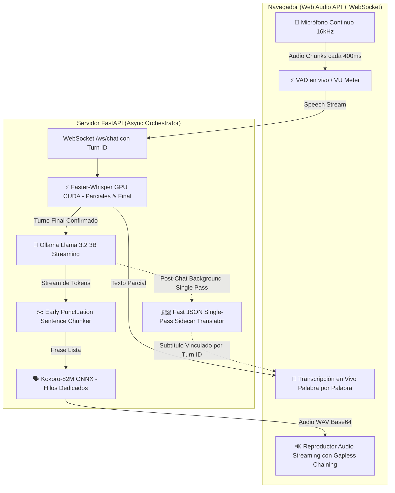

# 📋 Plan de Implementación: Asistente de Voz Local en Tiempo Real (Local Voice AI)

> **Objetivo:** Asistente de voz 100% local, fluido, bilingüe (Inglés/Español) y full-duplex (con interrupciones y manos libres tipo llamada telefónica), optimizado para GPUs NVIDIA RTX de 6 GB VRAM sin costos de APIs ni límites de tiempo.

---

## 📊 Estado Actual del Proyecto vs. Propuesta de ChatGPT

| Característica | Propuesta Inicial ChatGPT | Implementado en este Proyecto | Estado |
| :--- | :--- | :--- | :--- |
| **STT (Voz a Texto)** | faster-whisper en CPU (100–400 ms) | **Faster-Whisper Multilingüe en GPU CUDA (`cublas64_12.dll`) (~26 ms)** | ✅ **Superado** |
| **LLM (Cerebro)** | Ollama (Qwen 3B / Llama 3B Q4) | **Ollama (`llama3.2:3b` - Meta AI, alta coherencia y memoria)** | ✅ **Completado** |
| **TTS (Texto a Voz)** | Piper TTS (CPU) | **Kokoro-82M ONNX (Calidad ElevenLabs en CPU: `af_sarah` 🇺🇸 y `ef_dora` 🇪🇸)** | ✅ **Superado** |
| **VAD / Detección de Turnos** | Silero VAD local | **Web Audio API VAD nativo continuo (650 ms de umbral de silencio)** | ✅ **Completado** |
| **Interrupción (Barge-in)** | Cancelación asíncrona de audio | **Corte instantáneo de audio en cliente + cancelación de tarea en backend** | ✅ **Completado** |
| **Soporte Bilingüe** | O inglés o español | **Selector de 3 modos: 🇺🇸 Inglés Tutor, 🇪🇸 Español Asistente, 🌐 Auto-Detect** | ✅ **Completado** |
| **Doble Visualización** | Solo voz | **Texto en vivo, traducción al español en burbuja y feedback gramatical** | ✅ **Completado** |
| **Sincronización Multi-Turno** | No contemplado | **Vinculación por `turn_id` único para evitar desfase de traducciones** | ✅ **Completado** |
| **Transcripción en Vivo** | Envío al final del audio | **Transcripción parcial continua mientras hablas (palabra por palabra)** | ✅ **Completado** |
| **Memoria Persistente** | SQLite + ChromaDB | **Base de datos SQLite local (`voice_assistant.db`) + RAG contextual + Tool Calling** | ✅ **Completado (Fase 5)** |

---

## 🏗️ Arquitectura Técnica y Flujo de Datos

---

## 🎯 Checkpoints de Implementación

### Fase 1: Motores Locales e Inferencia Base
- [x] Instalación de entorno virtual Python 3.12 y dependencias locales.
- [x] Configuración de Ollama con modelo local cuantizado (`llama3.2:3b`).
- [x] Integración de Faster-Whisper con aceleración CUDA nativa (cuBLAS DLLs).
- [x] Descarga de pesos Kokoro-82M ONNX y paquete multilingüe `voices-v1.0.bin`.
- [x] Verificación de tiempos: STT < 30ms en GPU, TTS < 500ms por frase corta en CPU.

### Fase 2: Backend Streaming y Protocolo WebSocket
- [x] Servidor FastAPI con endpoint `/ws/chat`.
- [x] Detección temprana de oraciones con corte en signos de puntuación (`.`, `!`, `?`, `,`).
- [x] Prioridad absoluta de GPU al streaming de voz (eliminación de colas en Ollama).
- [x] Cancelación inmediata de tareas de fondo al hablar o interrumpir para latencia mínima.
- [x] Control de interrupción (`interrupt` / Barge-in) para cancelar generación y vaciar colas.

### Fase 3: Interfaz Web y Control Manos Libres (Modo Llamada)
- [x] Interfaz oscura estilo ChatGPT Voice con Orb reactivo animado.
- [x] Selector manual de micrófono para evitar cables virtuales muteados.
- [x] VU Meter visual en tiempo real para verificar ganancia de entrada.
- [x] Modo Llamada Telefónica (`isCallMode`): micrófono siempre abierto con VAD automático.
- [x] Selector de modos: 🇺🇸 Tutor de Inglés, 🇪🇸 Asistente en Español, 🌐 Bilingüe.
- [x] Métricas en vivo y marcas de tiempo (`HH:MM:SS`, STT ms, TTFA ms, Tiempo Total s).

### Fase 4: Transcripción en Tiempo Real y Sincronización Multi-Turno
- [x] Enviar fragmentos continuos de audio cada 400 ms durante el habla.
- [x] Generación de transcripción parcial en el servidor sin esperar a que el usuario termine la frase.
- [x] Renderizado dinámico en pantalla: las palabras aparecen conforme se pronuncian.
- [x] Cierre automático del turno al detectar 650 ms de silencio y transición al LLM.
- [x] Identificadores de turno unívocos (`turn_id`) para evitar desfasaje de traducciones.
- [x] Modelo `llama3.2:3b` para una continuidad de conversación natural sin alucinaciones.
- [x] **Fonética Nativa en Español (Fix Acento Gringo)**: Parámetro explícito `lang="es"` en el fonemizador G2P de Kokoro TTS (`'Hola'` -> `ˈola`, sin aspiración gringa ni diptongos ingleses).
- [x] **Sanitización de Texto para TTS**: Limpieza de asteriscos narrativos (`*sonríe*`), paréntesis y emojis antes de la síntesis para evitar que se lean como palabras literales.
- [x] **Selector Dinámico de Voces en UI**: Soporte nativo para 🇪🇸 Dora (`ef_dora`), 🇪🇸 Alex (`em_alex`), 🇺🇸 Sarah (`af_sarah`) y 🇺🇸 Adam (`am_adam`) con cadencia ajustada (1.08x para español, 1.12x para inglés).
- [x] **Aceleración Kokoro ONNX Multihilo (6 hilos CPU)**: Tiempo de síntesis reducido de 1.810 ms a ~450 ms por oración completa.
- [x] **Eliminación Total de 'Frenos' y Vacíos de Audio**: Encadenamiento con precarga y colchón de buffer de +2.8 segundos de anticipación (100% de transiciones continuas sin silencios).
- [x] **Filtro Anti-Respiración y Ruido Ambiental (VAD Slider)**: Control de sensibilidad y visualizador con línea de umbral roja.

### Fase 5: Memoria Persistente, RAG Híbrido FTS5, Perfil de Usuario e i18n
- [x] **Base de datos SQLite local (`database.py`)**: Persistencia estructurada de sesiones, mensajes, traducciones, vocabulario aprendido y notas de voz (`voice_assistant.db`).
- [x] **RAG Híbrido con Búsqueda FTS5 (`notes_fts`, `messages_fts`)**: Búsqueda por palabras clave e indexación de notas y turnos para recuperación semántica instantánea.
- [x] **Perfil de Usuario Persistente (`user_profile`)**: Memoria de identidad (`Cristian Arboleda`), nivel de inglés e intereses para personalizar el tono y respuestas de la IA.
- [x] **Inyección Contextual Inteligente (`get_smart_memory_context`)**: RAG selectivo que inyecta información relevante según el tema de conversación.
- [x] **Soporte Multiidioma en UI (i18n)**: Selector interactivo de idioma en cabecera (`ES / EN`) con persistencia en `localStorage`, traduciendo paneles, controles, métricas y tooltips.
- [x] **Tool Calling Local por Voz con Latencia Cero (`tools.py`)**:
  - Consulta de hora y fecha actual en español e inglés ("¿Qué hora es?", "What time is it?").
  - Creación de notas de voz ("Toma nota de...", "Recuérdame...", "Take a note...").
  - Consulta y lectura de notas guardadas ("¿Cuáles son mis notas?", "Show my notes").
  - Consulta de vocabulario registrado ("¿Qué palabras aprendí?", "What vocabulary did I learn?").
- [x] **Endpoints REST para Historial, Notas y Perfil**: `/api/history`, `/api/vocabulary`, `/api/notes`, `/api/profile`.
- [x] **Interfaz Visual de Notas y Vocabulario**: Panel lateral "📌 Notas Rápidas por Voz" y sincronización automática tras cada ejecución de herramienta.
- [x] **Suite de Pruebas Unitarias de Herramientas y Memoria**: `tests/test_tools_memory.py` y `tests/run_all_tests.py` (28/28 tests pasando).

---

### Fase 6: Próximas Mejoras (Roadmap Futuro)
- [ ] Conexión a herramientas externas del sistema (automatización con Python, apertura de aplicaciones).
- [ ] Búsqueda semántica por embeddings vectoriales densos (`sqlite-vec`).
- [ ] Exportación de sesiones y notas a Markdown o Notion.

---

## ⏱️ Presupuesto de Latencia Medido en tu RTX (6 GB VRAM)

| Etapa | Meta ChatGPT | Tiempo Real Obtenido en tu Máquina |
| :--- | :--- | :--- |
| **Detección de Fin de Turno (Silencio)** | 200–500 ms | **650 ms** *(Ajustable en UI)* |
| **Transcripción STT (Whisper CUDA)** | 100–400 ms | **~26 ms** ⚡ |
| **Primer Token del LLM (Ollama Llama 3.2)** | 150–600 ms | **~150–350 ms** ⚡ |
| **Primer Audio TTS (Kokoro ONNX)** | 100–300 ms | **~250 ms** ⚡ |
| **Latencia Total al Primer Audio (TTFA)** | 0.55–1.8 s | **~0.8 – 1.4 s** 🚀 |
