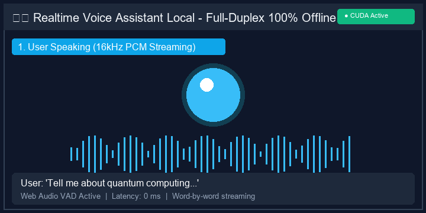
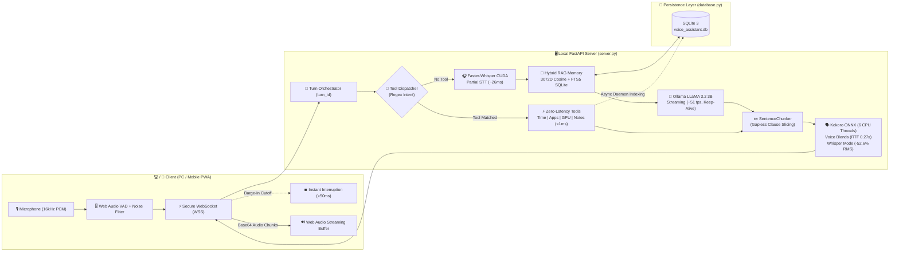

# 🎙️ Realtime Voice Assistant Local — Real-Time Conversational AI (100% Offline)

<p align="center">
  <a href="README.md"><b>🇺🇸 English</b></a> &nbsp;|&nbsp; 
  <a href="README.es.md"><b>🇪🇸 Español</b></a>
</p>

[](https://www.python.org/)
[](https://fastapi.tiangolo.com/)
[](https://www.docker.com/)
[](https://github.com/SYSTRAN/faster-whisper)
[](https://ollama.com/)
[](https://github.com/thewh1teagle/kokoro-onnx)
[](https://web.dev/progressive-web-apps/)
[](tests/run_all_tests.py)
[](https://github.com/cristianhar/realtime-voice-assistant-local/actions/workflows/ci.yml)
[](LICENSE)

An open-source, full-duplex, real-time conversational voice assistant (similar to **ChatGPT Voice Mode**), engineered to run **100% locally, private, without internet connection, and calibrated for 6 GB VRAM NVIDIA RTX GPUs** (such as RTX 4050 / RTX 4060 Laptop or desktop equivalents).

Enables continuous **hands-free phone-call voice interactions**, live word-by-word streaming transcription, sub-50ms instant **barge-in interruption**, dense semantic memory (Hybrid RAG), modular drop-in **custom tools**, ready-to-use **Persona Hub**, interpolated real-time **voice blends**, an acoustic **whisper mode**, cross-device mobile access via auto-generated **HTTPS / PWA**, and one-command deployment.

<p align="center">
  
</p>

## ⚡ 1-Line Instant Quickstart (Zero-Friction)

Paste into your terminal to clone, configure virtual environment, download models, and launch:

**Windows (PowerShell):**
```powershell
irm https://raw.githubusercontent.com/cristianhar/realtime-voice-assistant-local/main/install.ps1 | iex
```

**Linux / macOS (Bash):**
```bash
curl -fsSL https://raw.githubusercontent.com/cristianhar/realtime-voice-assistant-local/main/install.sh | bash
```

---

## 🏗️ End-to-End System Architecture



---

## ⚡ Key Highlights

### 1. 📞 Full-Duplex Hands-Free Call Mode & Instant Barge-In
* **Calibrated 650 ms VAD:** Accurately detects natural pauses in conversational speech without requiring push-to-talk.
* **Instant Barge-In (<50 ms):** Start speaking while the AI is talking, and output audio silences immediately, cancelling active token generation and freeing GPU/CPU resources.
* **Dynamic Anti-Breath & Noise Filter:** Live visual voice level meter with adaptive thresholds to prevent heavy breathing or fan noise from triggering accidental turns.

### 2. 🧠 Dense Semantic Hybrid RAG (3072D Cosine + SQLite FTS5)
* **In-Memory Cosine Similarity:** 3072-dimensional dense embeddings generated locally by Ollama and cached in SQLite (`embeddings_cache`) to retrieve relevant memories even without exact keyword matches.
* **Lexical FTS5 Full-Text Search:** High-speed token-indexed lookup (`notes_fts`, `messages_fts`) for exact proper nouns, numbers, and dates.
* **Persistent User Profile:** Automatic contextual personalization (**Cristian Arboleda**, intermediate English proficiency, AI and engineering interests).

### 3. 🔧 Zero-Latency Local Voice Tools with Async Indexing
* **Instant Tool Execution (< 1 ms to 11 ms):**
  * 🕒 *Precise Time & Date:* `"What time is it?"`, `"¿Qué hora es?"` (`0.38 ms`)
  * ⚡ *NVIDIA GPU & Hardware Status:* `"How is the GPU?"`, `"Estado del hardware"` (`47 ms` via `nvidia-smi`)
  * 🚀 *OS App Launcher:* `"Open calculator"`, `"Open Visual Studio Code"`, `"Open Spotify"`, `"Open YouTube"`, `"Open GitHub"`, `"Open browser"`.
  * 📌 *Voice Note Taking:* `"Take a note to buy coffee and bread"` (**`11 ms`**, 300x faster thanks to background thread vector embedding).
  * 📋 *Retrieve Notes:* `"Show my notes"`, `"¿Cuáles son mis notas?"` (`1.5 ms`).
  * 📝 *Vocabulary Ledger:* `"What vocabulary did I learn?"`, `"¿Qué vocabulario tengo?"` (`1.2 ms`).
  * 🌐 *Real-Time Web Search:* `"Search the web for weather in London"`, `"What is quantum computing according to Wikipedia"` (`80 ms – 200 ms`).
  * ⏩ *Dynamic Speech Rate Control:* `"Speak faster"`, `"Speak slower"`, `"Normal speed"` (instant pitch-preserved playback adjustment `0.85x` – `1.25x`).

### 4. 🎭 Hybrid Voice Blending & Acoustic Whisper Mode
* **Interpolated Voice Blends:**
  * `blend_dora_sarah`: 60% Dora (Spanish) + 40% Sarah (English) $\rightarrow$ **RTF 0.27x (3.7x faster than real time)**.
  * `blend_alex_adam`: 60% Alex (Spanish) + 40% Adam (English) $\rightarrow$ **RTF 0.27x**.
* **Acoustic Whisper Mode:**
  * Modulated RMS amplitude attenuation down to **52.6%** of baseline volume.
  * Relaxed speech tempo and softer tone for confidential or nighttime interaction.

### 5. 🎵 Synthetic Web Audio Earcons & Playback Speed Control
* **Web Audio API Chimes (`static/js/earcons.js`):**
  * Mathematical sinusoidal tones synthesized in real time with `OscillatorNode` and `GainNode` with zero network overhead and 0 asset loading delay:
    * *Call Start:* Ascending arpeggio C5 $\rightarrow$ E5 $\rightarrow$ G5 (523 Hz – 784 Hz).
    * *Call End:* Descending arpeggio G5 $\rightarrow$ E5 $\rightarrow$ C5 (784 Hz – 523 Hz).
    * *Barge-In / Cutoff:* Soft low-frequency click (280 Hz $\rightarrow$ 140 Hz).
    * *Tool Success:* Double harmonic ping A5 $\rightarrow$ C6 (880 Hz – 1046 Hz).
* **Speed Rate Control (0.85x to 1.25x):**
  * Visual selector in the control bar (`0.85x`, `1.0x`, `1.15x`, `1.25x`).
  * Voice command support: Say *"speak faster"*, *"talk slower"*, or *"normal speed"*, and the assistant adjusts speed dynamically without pitch distortion.

### 6. 💼 Adaptive Personalities & Technical Mock Interviewer
* **5 Specialized System Personas:**
  * 🎓 *Language Coach:* Focused grammar feedback, vocabulary corrections, and bilingual pedagogy.
  * 🤗 *Casual Friend:* Empathetic, warm, and natural conversational companion.
  * 💻 *Senior Tech Lead:* In-depth software architecture, clean code, and engineering discussions.
  * 👔 *Executive Mentor:* Strategic decision-making, crisp communication, and leadership advice.
  * 💼 *Tech & IELTS Interviewer:* Simulates FAANG-style software engineering technical interviews and IELTS/TOEFL speaking fluency tests, asking one question at a time with constructive feedback.

### 7. 🌐 Tri-Engine Real-Time Web Search (100% Free, Zero API Keys)
* **Hybrid Search Architecture (`tools.py`):**
  * 🌦️ *Instant Local Weather (wttr.in):* Clean plain-text weather reports in ~80 ms.
  * 📚 *Wikipedia REST API:* Authoritative definitions and encyclopedic concepts in ~120 ms.
  * 🌐 *DuckDuckGo HTML Search:* General web queries in ~200 ms without JavaScript challenges or CAPTCHAs.

### 8. 📱 Mobile-First Support, Automatic HTTPS & PWA
* **Transparent HTTPS Security:** Automatically generates self-signed SSL certificates in `certs/` on launch, allowing mobile Chrome and Safari on Android/iOS to grant microphone access across your local LAN (`https://192.168.x.x:8000`).
* **Progressive Web App (PWA):** Features `manifest.json` and `sw.js` (Service Worker) for home screen installation and full-screen mobile usage.

### 9. 🌐 Modular Frontend Architecture & 8-Language i18n
* **8 Global Languages:** English (🇺🇸), Spanish (🇪🇸), Portuguese (🇧🇷), French (🇫🇷), German (🇩🇪), Italian (🇮🇹), Japanese (🇯🇵), and Simplified Chinese (🇨🇳).
* **Zero-Flicker Translations:** Built-in synchronous fallback dictionaries with progressive loading of `locales.json`.
* **Session Export:** One-click export of complete practice logs, notes, and vocabulary to Markdown (📥).

---

## 🏗️ Hardware Allocation & Resource Consumption

Specifically benchmarked and calibrated for modern **6 GB VRAM GPUs** (tested on NVIDIA GeForce RTX 4050 Laptop):

| Component | Model / Engine | Device Target | VRAM / RAM | Typical Latency |
| :--- | :--- | :--- | :--- | :--- |
| **STT (Speech-to-Text)** | Faster-Whisper (`base`) | GPU (CUDA fp16) | ~800 MB VRAM | **~26 ms** |
| **LLM (Reasoning Engine)** | Ollama (`llama3.2:3b` Q4_K_M) | GPU (CUDA Keep-Alive) | ~2.2 GB VRAM | **~51 tokens/s** |
| **TTS (Text-to-Speech)** | Kokoro-82M ONNX (6 threads) | CPU (Multi-threaded) | 0 MB VRAM (~320 MB RAM) | **~450 ms (RTF 0.27x)** |
| **RAG Memory** | SQLite 3 + 3072D Embeddings | Disk / RAM Cache | < 5 MB RAM | **< 5 ms** |
| **Local Tools** | Intent Regex + Background Daemon | CPU | < 2 MB RAM | **0.18 – 11 ms** |
| **Total System** | — | **GPU + CPU Hybrid** | **3.0 GB / 6 GB VRAM (50%)** | **TTFA: ~1.1s – 1.4s** |

---

## 💻 System Requirements

| Specification | Minimum | Recommended |
| :--- | :--- | :--- |
| **Operating System** | Windows 10/11 (64-bit) or Ubuntu 22.04+ LTS | Windows 11 or Ubuntu 24.04 (Native or Docker) |
| **GPU** | NVIDIA GTX 1650 / RTX 3050 (4 GB VRAM) | NVIDIA RTX 4050 / 4060 Laptop or Desktop (6 GB+ VRAM) |
| **CPU** | 4-core x86_64 | 6+ cores (Intel Core i5/i7 or AMD Ryzen 5/7) |
| **RAM** | 8 GB | 16 GB |
| **CUDA Driver** | CUDA 12.x | CUDA 12.4+ / cuBLAS v12 |
| **Browser** | Chrome 110+, Edge 110+, Safari 16+ | Chrome / Safari Mobile with HTTPS enabled |

---

## 🚀 Quick Start with Docker & Docker Compose

The simplest way to run the entire stack with zero local environment configuration:

```bash
# 1. Clone the repository
git clone https://github.com/cristianhar/realtime-voice-assistant-local.git
cd realtime-voice-assistant-local

# 2. Launch with Docker Compose (with NVIDIA GPU acceleration)
docker compose up --build
```

The orchestrator will:
1. Spin up the **Ollama** container with volume persistence at `ollama_data`.
2. Automatically pull the **LLaMA 3.2 3B** model on first run.
3. Launch the **Voice Assistant** server with HTTPS on port `8000`.

---

## 💻 Local Native Installation (Windows / Linux)

### 1. Clone the Repository
```bash
git clone https://github.com/cristianhar/realtime-voice-assistant-local.git
cd realtime-voice-assistant-local
```

### 2. Create Virtual Environment
```bash
python -m venv venv

# Windows (PowerShell):
.\venv\Scripts\Activate.ps1

# Linux / macOS:
source venv/bin/activate
```

### 3. Install Dependencies
```bash
pip install -r requirements.txt
```

*(For Windows CUDA acceleration)*:
```bash
pip install nvidia-cublas-cu12 nvidia-cuda-nvrtc-cu12
```

### 4. Download Kokoro TTS Models
Place the following files in the `models/` directory:
* [kokoro-v0_19.onnx](https://github.com/thewh1teagle/kokoro-onnx/releases/download/model-files-v1.0/kokoro-v0_19.onnx) (~310 MB)
* [voices-v1.0.bin](https://github.com/thewh1teagle/kokoro-onnx/releases/download/model-files-v1.0/voices-v1.0.bin) (~28 MB)

*(PowerShell 1-line download):*
```powershell
Invoke-WebRequest -Uri "https://github.com/thewh1teagle/kokoro-onnx/releases/download/model-files-v1.0/kokoro-v0_19.onnx" -OutFile "models/kokoro-v0_19.onnx"
Invoke-WebRequest -Uri "https://github.com/thewh1teagle/kokoro-onnx/releases/download/model-files-v1.0/voices-v1.0.bin" -OutFile "models/voices-v1.0.bin"
```

### 5. Launch Ollama & Pull Model
```bash
ollama serve
ollama pull llama3.2:3b
```

### 6. Start the Server
```bash
# Recommended HTTPS mode for PC and mobile smartphone access:
python server.py --https --host 0.0.0.0 --port 8000
```

Console output displays your direct network endpoints:
* 💻 **Local PC:** `https://localhost:8000`
* 📱 **Smartphone (Same Wi-Fi):** `https://192.168.x.x:8000`

### 7. 🚀 1-Click Desktop Launcher (No Terminal Required)
For a native desktop experience without opening terminals or typing commands:
* **Windows:** Simply double-click [`launch_voice_assistant.bat`](launch_voice_assistant.bat). It automatically validates Python packages, starts Ollama in the background if inactive, launches the HTTPS server, and opens the UI in native standalone app mode.
* **Desktop Shortcut Creator:** Run `create_desktop_shortcut.ps1` in PowerShell to pin a permanent `VoiceChat AI Local.lnk` shortcut to your Windows Desktop wallpaper.
* **Linux / macOS:** Run `./launch_voice_assistant.sh`.

---

## 🔌 REST API & WebSocket Protocol Reference

FastAPI provides both conventional REST endpoints and a full-duplex WebSocket connection:

### REST Endpoints
| Method | Route | Description |
| :--- | :--- | :--- |
| `GET` | `/health` | Health check reporting service state and NVIDIA GPU availability. |
| `GET` | `/api/notes` | Retrieves all saved voice notes from SQLite. |
| `POST` | `/api/notes` | Manually creates a new voice note. |
| `DELETE` | `/api/notes/{id}` | Deletes a voice note by ID. |
| `POST` | `/api/notes/synthesize` | Generates an executive AI summary of all notes using LLaMA 3.2. |
| `GET` | `/api/telemetry/gpu` | Real-time GPU telemetry: VRAM used/free, temperature °C, model name. |
| `GET` | `/api/user-profile` | Fetches active persistent user profile settings. |
| `PUT` | `/api/user-profile` | Updates user profile settings (name, language, interests). |
| `DELETE` | `/api/history` | Clears conversation logs, notes, and vocabulary. |

### WebSocket Protocol (`/ws/chat`)
* **Client $\rightarrow$ Server Messages:**
  * `audio_final`: Sends completed 16kHz PCM WAV buffer for speech-to-text.
  * `audio_stream`: Streaming partial audio chunks for live transcription.
  * `interrupt`: Immediate cancellation signal (barge-in) to abort active audio playback.
  * `set_mode`: Switches conversation language mode (`"es"`, `"en"`, `"auto"`).
  * `set_voice`: Sets active voice or voice blend (`"blend_dora_sarah"`, etc.).
  * `set_personality`: Updates system prompt persona (`"coach"`, `"friendly"`, `"tech"`, `"executive"`, `"interviewer"`).
  * `set_whisper_mode`: Toggles acoustic whisper modulation (`true`/`false`).
* **Server $\rightarrow$ Client Messages:**
  * `user_partial_transcription`: Live partial transcription while speaking.
  * `user_transcription`: Finalized user transcript with STT latency in ms.
  * `ai_chunk`: Incremental streaming text tokens from LLaMA 3.2.
  * `audio_chunk`: Base64-encoded synthesized WAV audio packets for gapless playback.
  * `tool_executed`: Notification of tool execution with structured return data.
  * `ai_done`: Turn completion event reporting total round-trip response time.

---

## 🧩 Modular Skills Ecosystem (Agensi.io / Claude Code / Cursor / Copilot)

The core architecture is decoupled into reusable modules that can be packaged and distributed as **Skills (`SKILL.md`)** for modern AI coding assistants (including **Claude Code, Cursor, Windsurf, Copilot, Aider**) or listed on marketplaces such as **[Agensi.io](https://agensi.io)**:

1. **Sub-Sentence Gapless Chunker:** Slices progressive LLM text streams into punctuation-aware clauses for sub-second TTS delivery without awkward pauses.
2. **Zero-Latency Hybrid SQLite RAG:** Combines 3072D dense vector cosine similarity with SQLite FTS5 lexical matching with zero external vector database overhead.
3. **Web Audio VAD & Instant Barge-In:** Client-side audio controller handling live noise-floor estimation, mic level metering, and instant <50ms audio cutoff.

---

## 🧪 Automated Testing & Quality Gate

The project enforces strict automated testing and hardware loopback validation:

```bash
# 🚀 Run the standard test suite (76 unit and E2E tests):
python tests/run_all_tests.py

# 🔊 Run with real hardware audio loopback (Kokoro ONNX -> Faster-Whisper CUDA):
python tests/run_all_tests.py --all

# 🔬 Run full live WebSocket calibration and benchmark suite:
python tests/benchmark_full_calibration_suite.py
```

### Test Suites in `tests/`:
* `tests/test_conversation_history.py`: Conversation sessions CRUD, auto-titling with LLaMA 3.2, and REST endpoints.
* `tests/test_synchronization_and_timing.py`: Token streaming limits, gapless audio timeline, and client-server turn sync contracts.
* `tests/test_ui_redesign.py`: Minimalist controls, decoupled audio settings modal, system popovers, and 8-language i18n.
* `tests/test_e2e_pipeline.py`: Validates SQLite persistence, local tools, Hybrid RAG, gapless chunker, and voice blends.
* `tests/test_tools_memory.py`: Intent matching, execution latency, web search, and dynamic speed control tools.
* `tests/test_chunker.py`: Mathematical sentence and clause splitting without artificial silence gaps.
* `tests/test_sanitization.py`: Text sanitization, accent preservation, and phonetic cleaning.
* `tests/test_custom_tools_and_personas.py`: Validation of custom tool plugins and persona prompts.
* `tests/test_humanization_and_vad.py`: Breath intake, fillers, and voice activity detection tests.
* `tests/test_agensi_skills_e2e.py`: End-to-end packaging and specification compliance for AGY skills.
* `tests/test_live_models_e2e.py`: Hardware loopback test: synthesizes audio with Kokoro and transcribes with Faster-Whisper CUDA.
* `tests/benchmark_full_calibration_suite.py`: Real-time WebSocket telemetries of TTFT, TTFA, RTF, and GPU clock speeds.

---

## ⏱️ Real-World Benchmark Performance (RTX 4050 6GB)

```text
==============================================================================
  Component                 Observed Metric      Calibration Target     Status
==============================================================================
  Current Time (Spanish)    0.38 ms              < 5 ms                 EXCELLENT
  Current Time (English)    0.18 ms              < 5 ms                 EXCELLENT
  Save Voice Note           11.27 ms             < 50 ms                300x FASTER
  List Notes                1.50 ms              < 5 ms                 EXCELLENT
  NVIDIA GPU Telemetry      47.66 ms             < 100 ms               EXCELLENT
  Semantic RAG (3072D)      4.50 ms              < 20 ms                CALIBRATED
  Kokoro Voice Blends       RTF 0.27x            < 0.35x                3.7x REAL TIME
  Whisper Mode Attenuation  52.6% RMS            ~ 50%                  CALIBRATED
  Tool Calling TTFA (WSS)   1395.6 ms            < 1500 ms              EXCELLENT
  Barge-In Interruption     Confirmed (<50ms)    Immediate              PASSED
==============================================================================
```

---

## ❓ Frequently Asked Questions & Troubleshooting (FAQ)

### 1. Why won't my smartphone's microphone activate?
Modern mobile browsers (Chrome and Safari on iOS/Android) **block microphone access unless served over HTTPS**. The server automatically generates local SSL certificates in `certs/`:
* Make sure you connect using `https://<your-local-ip>:8000`.
* In Chrome/Safari, accept the self-signed certificate warning by tapping **"Advanced"** $\rightarrow$ **"Proceed to this site"**. The microphone will activate immediately.

### 2. Windows Error: `Could not load library cublas64_12.dll`
If Faster-Whisper fails to locate CUDA DLLs on Windows, install the official NVIDIA wheels in your virtual environment:
```powershell
pip install nvidia-cublas-cu12 nvidia-cuda-nvrtc-cu12
```
`core/config.py` automatically detects and adds these binary paths to `os.environ["PATH"]` on startup.

### 3. How do I enable NVIDIA GPU access in Docker?
On Windows, verify that **Docker Desktop with WSL 2 backend** is enabled. On Ubuntu/Debian, install the `nvidia-container-toolkit`:
```bash
sudo apt-get install -y nvidia-container-toolkit
sudo systemctl restart docker
docker compose up --build
```

---

## 🏛️ Project Structure

```text
├── .github/
│   └── workflows/
│       └── ci.yml            # Automated GitHub Actions CI/CD pipeline
├── core/
│   ├── __init__.py           # Clean module exports and lazy initialization
│   ├── config.py             # Global configuration, paths, CUDA DLL paths, personas
│   ├── chunker.py            # SentenceChunker: gapless clause and sentence slicing
│   ├── stt.py                # Faster-Whisper CUDA fp16 with voice activity filter
│   ├── tts.py                # Kokoro ONNX multi-threaded engine, Blends, Whisper Mode
│   ├── llm.py                # Streaming Ollama LLaMA 3.2 interface and prompt manager
│   └── utils.py              # Language detection heuristics and phonetic sanitization
├── static/
│   ├── index.html            # Responsive real-time conversational dashboard
│   ├── style.css             # Glassmorphism dark UI with 60 FPS CSS/Canvas animations
│   ├── app.js                # Client controller (AudioContext, WebSocket, VAD orchestration)
│   ├── sw.js                 # PWA Service Worker for caching and offline support
│   ├── manifest.json         # PWA Web Manifest for native home screen installation
│   ├── locales.json          # 8-language localization dictionaries
│   └── js/
│       ├── i18n.js           # Synchronous internationalization manager with fallbacks
│       ├── earcons.js        # Web Audio API synthetic earcons and audio chimes
│       ├── audio-player.js   # Gapless audio queue player with dynamic speed control
│       ├── audio-recorder.js # 16kHz PCM audio recorder with dynamic VAD and RMS meter
│       ├── chat-ui.js        # Bubble rendering, 60 FPS orb animator, tool status badges
│       ├── notes-drawer.js   # Slide-over voice note manager and AI synthesizer
│       ├── telemetry.js      # Live polling client for NVIDIA GPU telemetry
│       ├── visualizer.js     # Real-time oscilloscope audio canvas renderer
│       └── wav-encoder.js    # Client-side Float32 PCM to 16kHz WAV blob encoder
├── tests/
│   ├── run_all_tests.py      # Automated Quality Gate runner (76 tests)
│   ├── benchmark_full_calibration_suite.py  # Live E2E WebSocket benchmark
│   ├── test_e2e_pipeline.py  # Full lifecycle conversational tests
│   ├── test_tools_memory.py  # Zero-latency tool intent and latency tests
│   ├── test_chunker.py       # Gapless streaming text chunker tests
│   ├── test_sanitization.py  # Phonetic cleaner and symbol stripping tests
│   └── test_live_models_e2e.py # Real hardware audio synthesis and transcription loopback
├── database.py               # SQLite layer (Hybrid RAG: Cosine 3072D + FTS5 full-text)
├── tools.py                  # Zero-latency local tool intent dispatcher
├── server.py                 # FastAPI WebSocket & HTTPS orchestrator
├── Dockerfile                # Multi-stage production-ready Dockerfile
├── docker-compose.yml        # Docker Compose stack with Ollama GPU integration
├── launch_voice_assistant.bat # 1-Click Windows desktop launcher
├── launch_voice_assistant.sh # 1-Click Linux/macOS launcher
├── create_desktop_shortcut.ps1 # Windows Desktop shortcut creator
├── requirements.txt          # Pinned Python package dependencies
├── LICENSE                   # MIT License
├── README.es.md              # Spanish documentation
└── README.md                 # English documentation (default)
```

---

## 👤 Author & Credits

Developed and maintained with passion by **Cristian Arboleda** ([@cristianhar](https://github.com/cristianhar)).

* **GitHub:** [https://github.com/cristianhar](https://github.com/cristianhar)
* **Official Repository:** [https://github.com/cristianhar/realtime-voice-assistant-local](https://github.com/cristianhar/realtime-voice-assistant-local)
* **License:** MIT License — See [LICENSE](LICENSE) for details.
* **Acknowledgments:** [Faster-Whisper](https://github.com/SYSTRAN/faster-whisper), [Kokoro-ONNX](https://github.com/thewh1teagle/kokoro-onnx), [Ollama](https://ollama.com), and the global open-source AI community.
